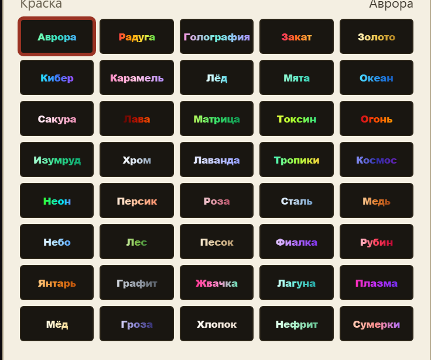
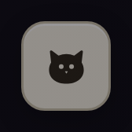

 

# Легион — Аддон для чата (colors)

Ники в чате переливаются всеми цветами: свой настраивается в панели, 
чужие приходят из общего списка.

&nbsp;

&nbsp;

 

<table>
<tr>
<td align="center" width="33%"><h3>40 красок</h3>у каждой своя траектория перелива</td>
<td align="center" width="33%"><h3>Свой стиль</h3>скорость, свечение, блик, @упоминания</td>
<td align="center" width="33%"><h3>Не мешает</h3>сворачивается в кнопку-котика</td>
</tr>
</table>

## Поставить

1. Поставь [Tampermonkey](https://www.tampermonkey.net/).
2. Открой [`legion-guild.user.js`](https://raw.githubusercontent.com/faldoor/legion-guild-extension/refs/tags/v1.10.1/legion-guild.user.js).
3. Нажми **Install**.

Панель — «формуляр»: краска, скорость, свечение, три галочки и поле «чей ник
переливается». Ничего не отправляется в чат, всё работает локально и в браузере.

 

Ещё

- Список красок гильдии: [`paints.json`](paints.json)
- Проверки интерфейса: [`tests/shimmer-ui.html`](tests/shimmer-ui.html) — 37 проверок, открывается в браузере
- Витрина для скриншотов: [`docs/demo.html`](docs/demo.html)

